# 🚗 HOLM Booking Cars

[](https://hacs.xyz/)


[🇫🇷 Français](README.md) · 🇬🇧 English

**Who's taking the car, and when? Book the family vehicle from Home Assistant: a weekly planner, booking in two taps, no overlap possible, and a reminder before you leave.**

HOLM Booking Cars keeps the **bookings** of one or more shared vehicles: who, from when to when, what for, where, how many kilometres. Two bookings can **never overlap**, even when two people confirm at the same moment. Each vehicle gets its own **calendar** and **sensors** (available, booked by…, next booking), and the **HOLM Booking Cars** card shows it all, with animations.

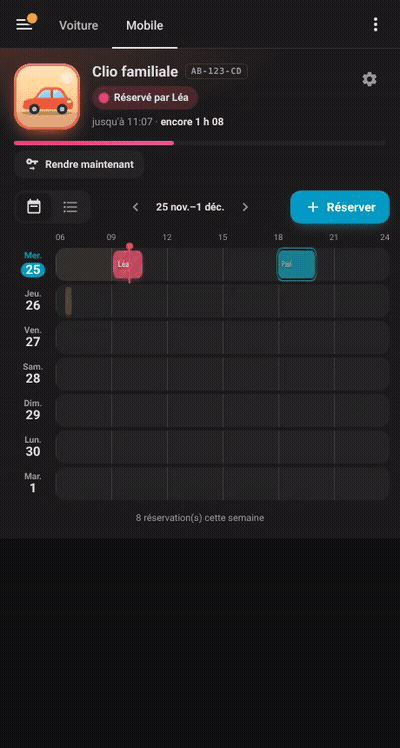

### At a glance

- 🗓️ **Weekly planner**: one row per day, bookings coloured per person, the current time in red. Tap a free slot to book.
- 📋 **List view**: upcoming bookings day by day, and the history.
- ➕ **Animated booking**: for whom, departure, return, one-tap durations, reason, destination, kilometres, note. Taken slots are shown and an overlap is flagged before you even save.
- 🚫 **No overlap**: checked by the integration, including two simultaneous requests.
- ✏️ **Edit or delete** by tapping a booking: everyone their own, administrators all of them (or everyone, your choice).
- 🔑 **Return now**: a vehicle brought back early frees the slot straight away.
- 🚙 **Several vehicles**, with photo, colour, icon, plate and battery or fuel level.
- 🔔 **Notifications**: reminder before departure, alert to the others when someone books or cancels, reminder to bring the vehicle back at the end time.
- 👤 **Everyone recognised automatically** by their Home Assistant account, with the option to book **for someone else**.
- 📅 **One calendar per vehicle**, also editable from the Home Assistant calendar, plus **sensors** for your automations.
- ⚙️ **Everything is set up from the card** (gear icon, administrators): vehicles, people, notifications, options.
- 🌍 **8 languages**: French, English, German, Spanish, Italian, Dutch, Portuguese, Polish.

| The weekly planner | The list |
|---|---|
| 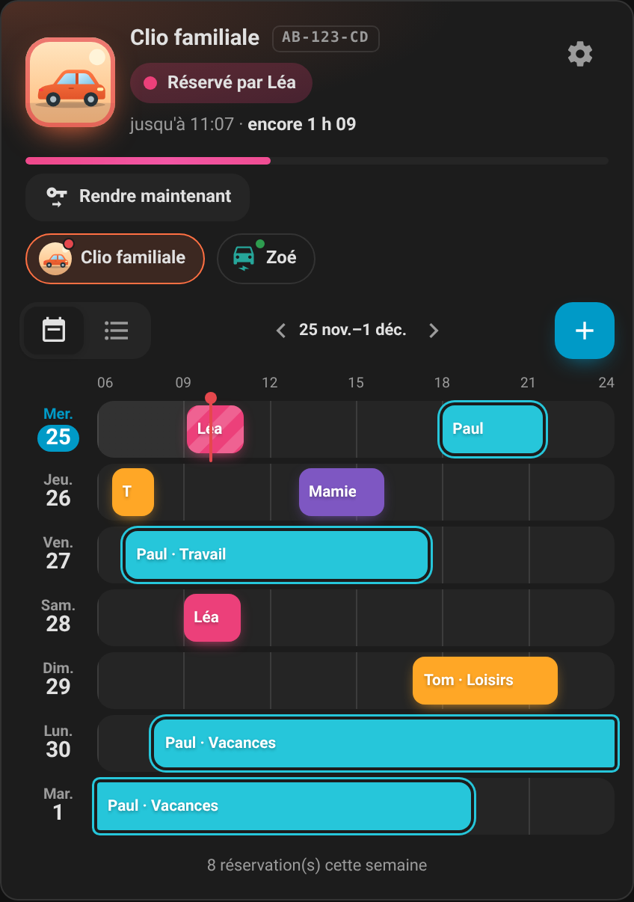 | 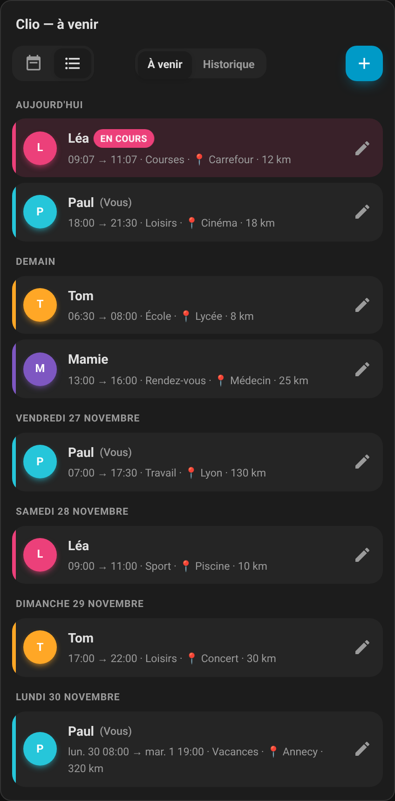 |

*Screenshots are in French; the card follows your Home Assistant language.*

---

## Installation

### With HACS (recommended)

1. HACS → ⋮ menu → **Custom repositories** → add `https://github.com/kaaribou/holm-booking-cars`, category **Integration**.
2. Search for **HOLM Booking Cars** → **Download**, then restart Home Assistant.

### Manually

Copy `custom_components/holm_booking_cars` into the `custom_components` folder of your configuration, then restart Home Assistant.

## Configuration

**Settings → Devices & services → Add integration → HOLM Booking Cars.**

Enter the **name of the first vehicle**. That's it: Home Assistant **people** are imported automatically (name and account), each with a colour.

Then add the **HOLM Booking Cars** card to a dashboard (it is registered automatically, no resource to add) and open the **gear ⚙** to add more vehicles, a photo, notifications…

## The HOLM Booking Cars card

### The header


- **The vehicle photo** (or its icon on its colour), its **name**, **plate** and, if set, the **battery or fuel level** (red below 20 %).
- **The status**, with a pulsing dot:
  - 🟢 **Available**, with "Free until …" and who goes next underneath, or "Nothing planned";
  - 🟠 **Available**, but a booking starts within the hour: "Léa leaves at 14:00 · in 35 min";
  - 🔴 **Booked by …**, on that person's colour, with the return time and time left ("1 h 10 left").
- **The progress bar** of the current booking, in the person's colour.
- **Return now** (for the person who has the vehicle, and administrators): ends the current booking immediately, the vehicle becomes available again.
- **The gear ⚙** (administrators) opens the [settings](#settings-gear-).

With several vehicles, a **chip per vehicle** lets you switch; its dot shows its state (green available, orange booked soon, red booked).

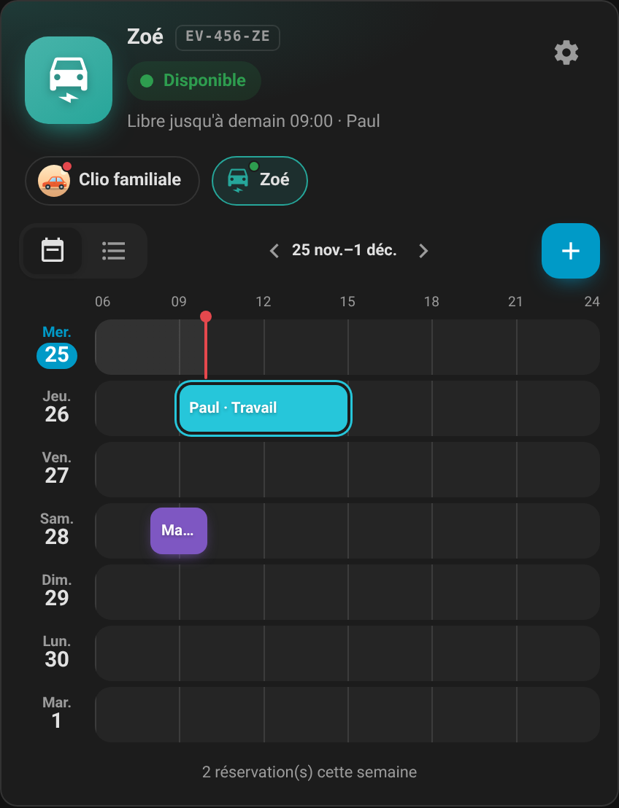

### The toolbar

- **Week / List**: the two views of the card.
- **‹ 25 Nov–1 Dec ›** (week view): previous or next week; tapping the dates goes back to today (they are coloured when you are not on the current week).
- **Upcoming / History** (list view): next bookings, or past ones.
- **＋ Book**: a new booking at the next free slot (the button shrinks to **＋** on a narrow card).

### The week view

- **One row per day** (today first by default), with hours at the top (6 am to midnight by default, see the [options](#card-options)).
- **Each booking** is a block in the person's colour, with their name and the reason when there is room. Hover it to see the exact times.
- **Your bookings** have an outline; **the current booking** is striped and animated; **past bookings** are paler. A multi-day booking spans each row.
- **The red line** marks the current time; the past part of the day is shaded.
- **Tap a free slot**: the booking window opens at that hour, for 2 h (or until the next booking). **Tap a booking** to view, edit or delete it.
- At the bottom, the number of bookings in the week.
- When changing week the planner **slides**; on opening, the blocks **unfold** one after the other.

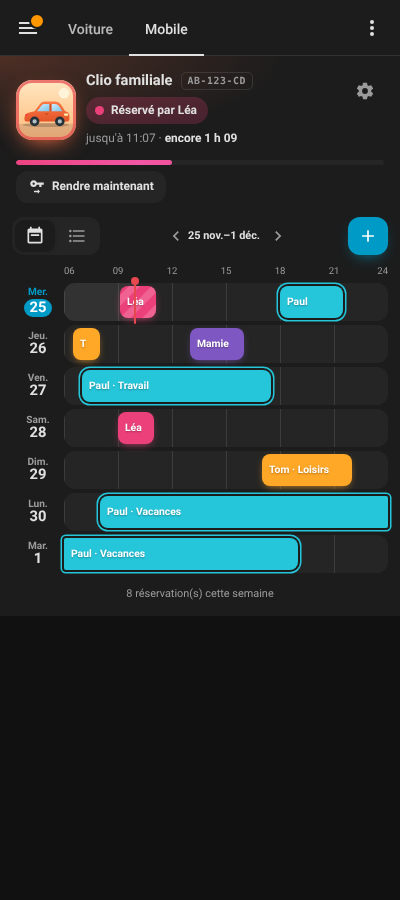

### The list view


Bookings **grouped by day** (Today, Tomorrow, then the date), with the person's initial on their colour, times, reason, destination 📍, kilometres and note. **Now** marks the active booking. The pencil ✏️ shows a booking you can edit, the arrow › one you can only view.

### Booking

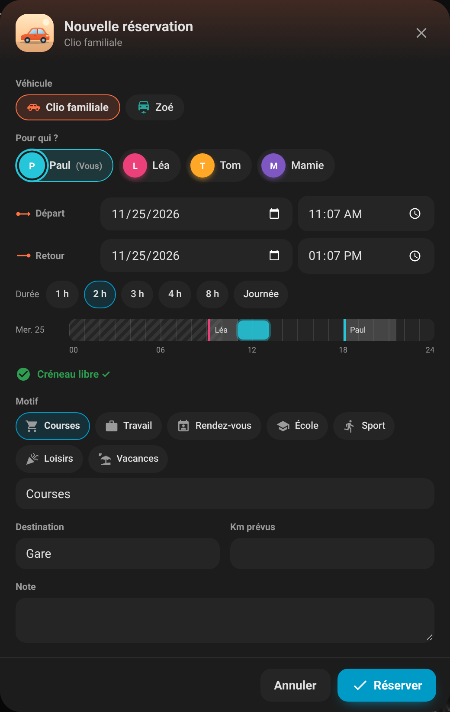

- **Vehicle** (if several) and **For whom?**: you are selected by default ("You"); tap someone else to book for them (they get notified).
- **Departure** and **Return**: date and time. Moving the departure moves the return too (the duration is kept).
- **Duration**: 1 h, 2 h, 3 h, 4 h, 8 h or **Full day** (8 am – 8 pm) in one tap.
- **Availability**: a strip for each day involved, with the others' bookings (greyed, with the person's name) and your slot in colour.
- **The message**: "Slot available ✓" in green, or in red what is wrong (overlap with whom and when, return before departure, too long, slot already over). The **Book** button stays greyed while it is red.
- **Reason**: in one tap (Shopping, Work, Appointment, School, Sport, Leisure, Holidays) or typed.
- **Destination**, **Planned km** and **Note**: optional.
- **Book**: a check mark draws itself, "Booked! Drive safe!", then the new booking pops into the planner.

| An overlap | On mobile |
|---|---|
| 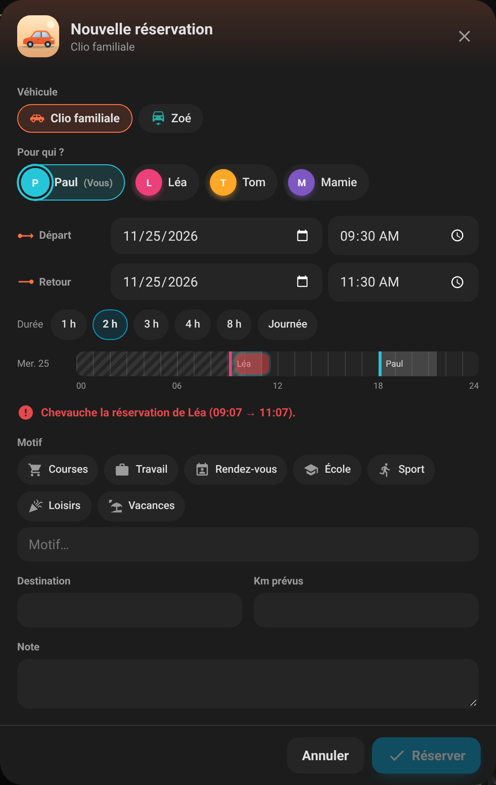 | 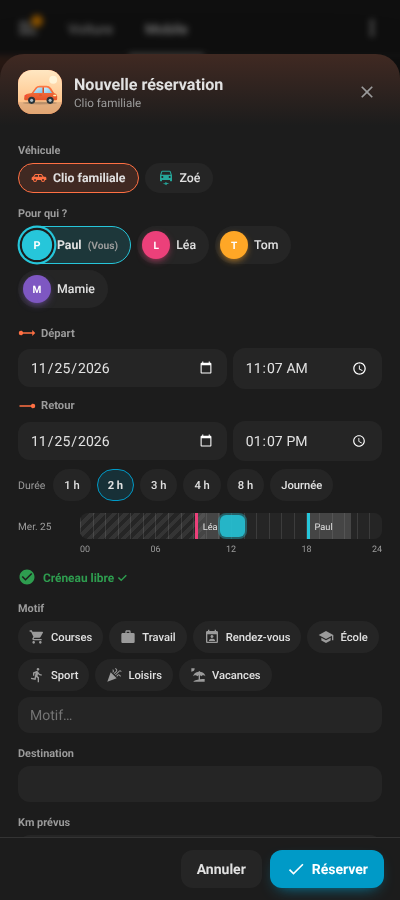 |

On mobile, the window slides up from the bottom of the screen.

### Editing, deleting

Tap a booking (block or list row):

- if you can edit it, the same window opens, with **Delete** at the bottom left (a confirmation is asked) and "Booked by … on …";
- otherwise it opens **read-only**, naming who can change it.

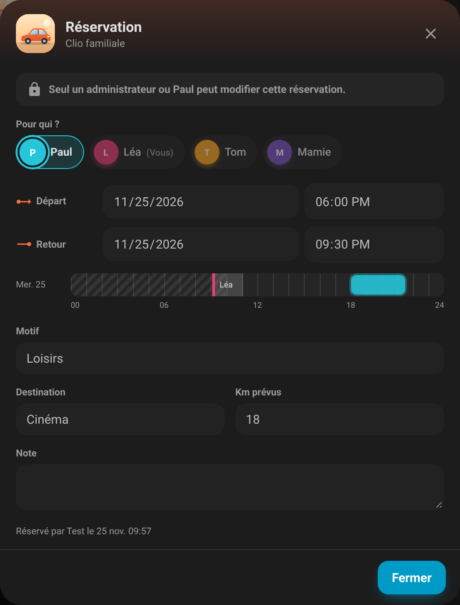

**Who can change what?** Everyone their own bookings (made by them, or in their name), and administrators all of them. The option *Everyone can edit every booking* lifts that limit.

Open cards update **live**: a booking made by someone else appears at once, without reloading the page. If the booking you are looking at is deleted elsewhere, the window closes with a message.

### Settings (gear ⚙)

Administrators only. Three tabs; nothing is saved before **Save**.

**Vehicles**

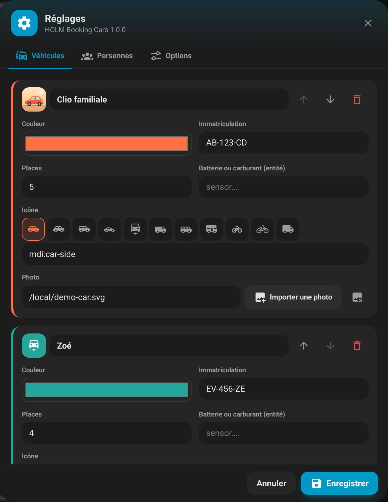

- **Name**, **Colour**, **Plate**, **Seats**.
- **Battery or fuel (entity)**: a sensor in % (or km, L) shown in the header, for example the battery level from [HOLM Cars](https://github.com/kaaribou/holm-cars).
- **Icon**: one of the suggested icons or any `mdi:…`.
- **Photo**: **Upload a photo** from your phone or computer, or enter an address (`/local/…`, `https://…`). The 🖼️✕ icon removes it.
- ↑ ↓ to reorder, 🗑️ to delete (two taps: the first asks for confirmation; its bookings are erased on save).
- **Add a vehicle**. Adding, deleting or renaming a vehicle recreates its entities.

**People**

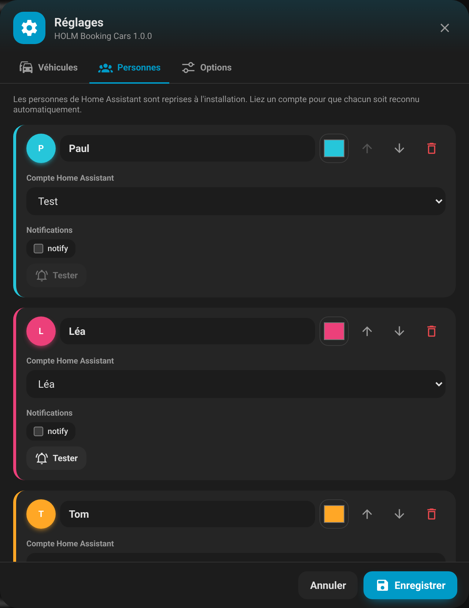

- **Name** and **colour** (used for their bookings).
- **Home Assistant account**: the person is recognised automatically when opening the card ("You") and can edit their bookings.
- **Notifications**: the devices receiving their reminders and alerts (mobile app or any `notify` service). **Test** sends a test notification (save first).
- **Add a person**: also for someone without an account ("Granny"), whom the others book for.

**Options**

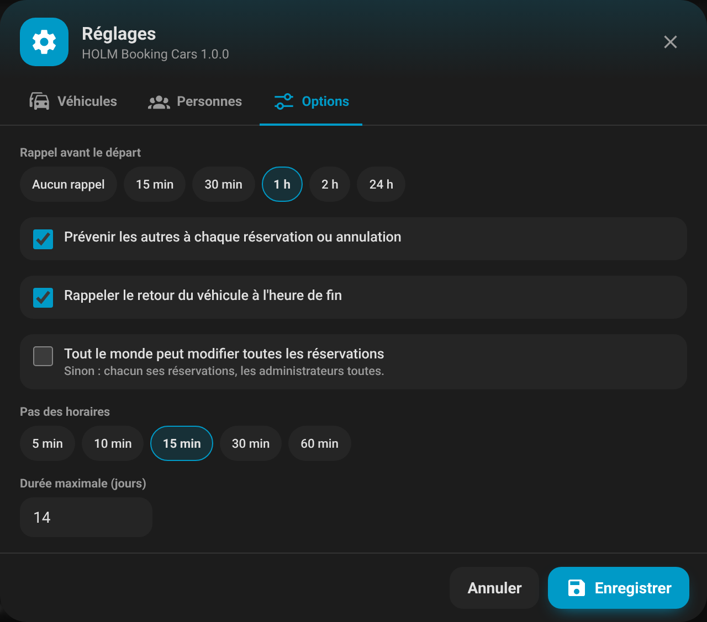

- **Reminder before departure**: none, 15 min, 30 min, 1 h, 2 h or 24 h before (no reminder for a last-minute booking).
- **Tell the others about each booking or cancellation**.
- **Remind to return the vehicle at end time**.
- **Everyone can edit every booking**.
- **Time step**: 5, 10, 15, 30 or 60 minutes for picking times.
- **Maximum duration (days)** of a booking (14 by default).

### Card options

All available in the visual editor:

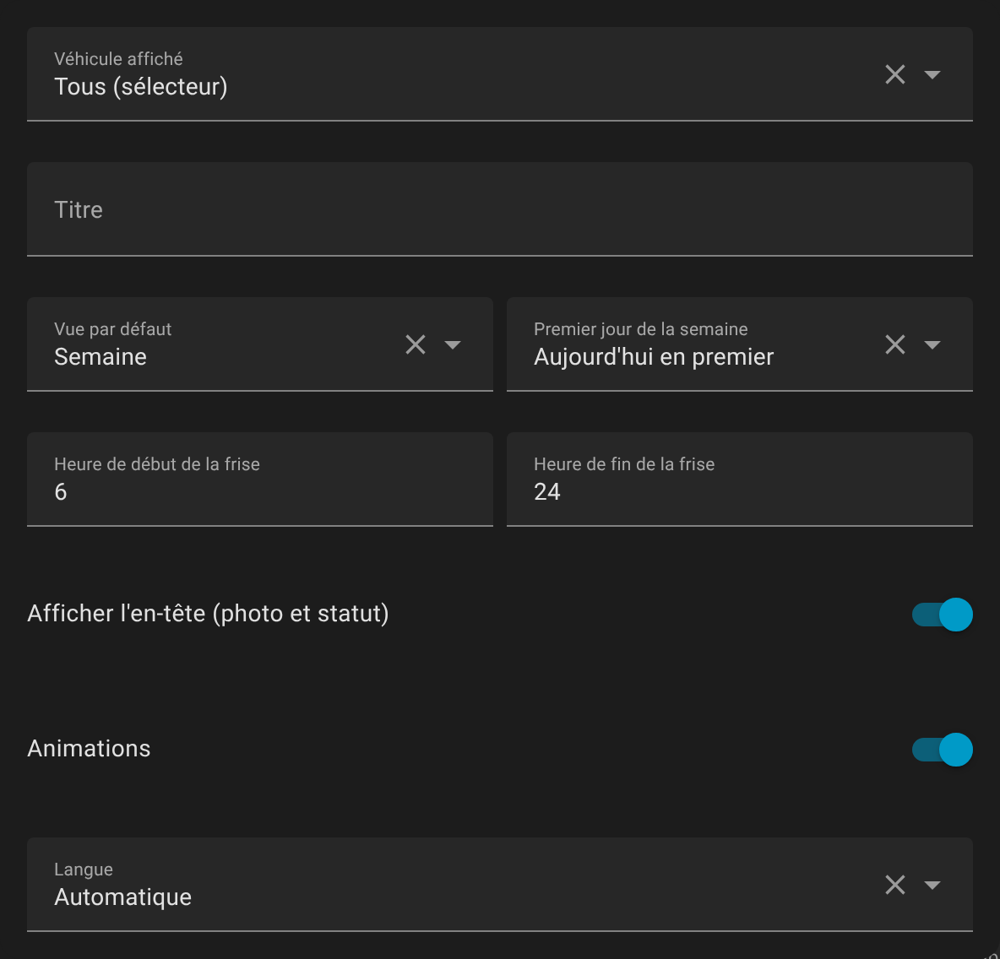

```yaml
type: custom:holm-booking-cars-card
vehicle: clio            # optional: a single vehicle (otherwise chips to choose)
title: Car               # optional
view: week               # week or list
first_day: today         # today (today first), monday or sunday
hours_from: 6            # timeline start hour
hours_to: 24             # timeline end hour
show_header: true        # photo and status
animations: true
language: auto           # or fr, en, de, es, it, nl, pt, pl
```

| Option | Default | Effect |
|---|---|---|
| `vehicle` | all | ID of the vehicle to show alone (`clio` for `sensor.clio_statut`). |
| `title` | — | Title above the card. |
| `view` | `week` | View on opening. |
| `first_day` | `today` | First day of the displayed week. |
| `hours_from` / `hours_to` | `6` / `24` | Hour range of the week view. |
| `show_header` | `true` | Hide the header for a compact "list" card. |
| `animations` | `true` | Turns off all animations (they are also reduced if your device asks for reduced motion). |
| `language` | `auto` | Card language (otherwise your profile's). |

The card follows your theme, light or dark:

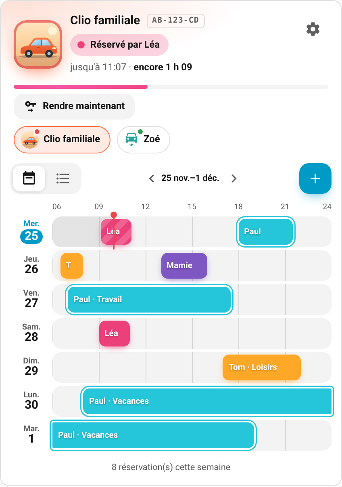

## Entities

For each vehicle (here `clio`):

| Entity | State | Attributes |
|---|---|---|
| `sensor.clio_statut` | `disponible` (available), `bientot` (booked within 1 h), `reserve` (booked) | `person`, `until`, `reason`, `destination`, `next_start`, `next_person`, `color`, `plate` |
| `sensor.clio_en_cours` | Name of the person who has the vehicle (empty otherwise) | `start`, `end`, `reason`, `destination`, `booking_id` |
| `sensor.clio_prochaine_reservation` | Date and time of the next booking | `person`, `end`, `reason`, `destination`, `booking_id` |
| `binary_sensor.clio_disponible` | `on` when nobody has the vehicle | — |
| `calendar.clio` | The bookings ("Léa — Shopping", location = destination) | — |

The **calendar** also accepts creating, editing and deleting from the Home Assistant calendar: an event "Léa — Pool" is booked for Léa with the reason "Pool" (overlaps are still refused).

## Actions

- `holm_booking_cars.book`: books (`vehicle`, `person`, `start`, `end`, `reason`, `destination`, `km`, `note`) and returns the booking. Refused on overlap.
- `holm_booking_cars.cancel`: deletes a booking (`booking_id`).
- `holm_booking_cars.finish`: ends a vehicle's current booking now (`vehicle`).

```yaml
action: holm_booking_cars.book
data:
  vehicle: clio
  person: lea
  start: "2026-12-01 08:00:00"
  end: "2026-12-01 12:00:00"
  reason: Shopping
```

## Event

`holm_booking_cars_booking` on every change, with `action` (`created`, `updated`, `deleted`, `started`, `ended`), `booking_id`, `vehicle`, `vehicle_name`, `person`, `person_name`, `start`, `end`, `reason`, `destination`. For example, to light the driveway when a booking starts at night:

```yaml
triggers:
  - trigger: event
    event_type: holm_booking_cars_booking
    event_data:
      action: started
```

## Good to know

- **Past bookings** stay 120 days in the history.
- **Times** are shown in your device's time zone; notifications use Home Assistant's.
- **Notifications** are sent in the Home Assistant language.

## FAQ

**"HOLM Booking Cars is not set up"** appears in the card. Add the integration in *Settings → Devices & services*, or check that it started (log).

**I am not recognised ("You" does not appear).** In the settings, *People* tab, link your **Home Assistant account** to your name.

**I don't get notifications.** Tick your devices in the *People* tab, save, then **Test**.

**I can't edit a booking.** It isn't yours: ask that person or an administrator, or enable *Everyone can edit every booking*.

---

## A little thank-you?

Like the integration? You can buy me a beer 🍺

[](https://paypal.me/kaaribou)

---

## License

Code: **MIT** license — © kaaribou. See the [CHANGELOG](CHANGELOG.md).

Part of **HOLM — Home Orchestration & Living Management**: smart management and orchestration of the home.

Other projects: [HOLM Cars](https://github.com/kaaribou/holm-cars) · [HOLM Bins](https://github.com/kaaribou/holm-bins) · [HOLM My Menu](https://github.com/kaaribou/holm-mymenu) · [HOLM HP/HC](https://github.com/kaaribou/holm-tarif) · [HOLM Navbar Card](https://github.com/kaaribou/holm-navbar-card) · [HOLM Shortcuts](https://github.com/kaaribou/holm-shortcuts) · [HOLM FX](https://github.com/kaaribou/holm-fx-card) · [HOLM Family Card](https://github.com/kaaribou/holm-family-card).
