# 🚗 HOLM Booking Cars

[](https://hacs.xyz/)


🇫🇷 Français · [🇬🇧 English](README.en.md)

**Qui prend la voiture, et quand ? Réservez le véhicule de la famille depuis Home Assistant : un planning de la semaine, une réservation en deux gestes, pas de chevauchement possible, et un rappel avant de partir.**

HOLM Booking Cars garde les **réservations** d'un ou de plusieurs véhicules partagés : qui, de quand à quand, pour quoi faire, où, combien de kilomètres. Deux réservations ne peuvent **jamais se chevaucher**, même si deux personnes valident en même temps. Chaque véhicule a son **calendrier**, ses **capteurs** (disponible, réservé par…, prochaine réservation) et la carte **HOLM Booking Cars** affiche le tout, avec des animations.

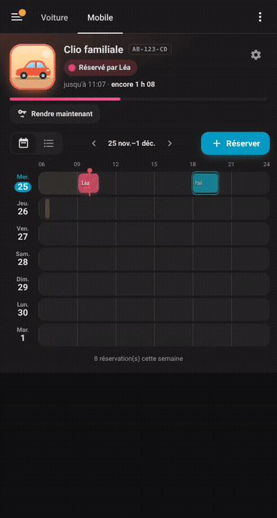

### En bref

- 🗓️ **Planning de la semaine** : une ligne par jour, les réservations en couleur par personne, l'heure actuelle en rouge. Touchez un créneau libre pour réserver.
- 📋 **Vue liste** : les réservations à venir jour par jour, et l'historique.
- ➕ **Réservation animée** : pour qui, départ, retour, durée en un geste, motif, destination, kilomètres, note. Les créneaux déjà pris sont affichés, un chevauchement est signalé avant même d'enregistrer.
- 🚫 **Aucun chevauchement** : vérifié par l'intégration, y compris pour deux demandes simultanées.
- ✏️ **Modifier ou supprimer** en touchant une réservation : chacun les siennes, les administrateurs toutes (ou tout le monde, au choix).
- 🔑 **Rendre maintenant** : le véhicule rendu en avance libère aussitôt le créneau.
- 🚙 **Plusieurs véhicules**, avec photo, couleur, icône, immatriculation et niveau de batterie ou de carburant.
- 🔔 **Notifications** : rappel avant le départ, alerte aux autres quand quelqu'un réserve ou annule, rappel de rendre le véhicule à l'heure de fin.
- 👤 **Chacun reconnu automatiquement** par son compte Home Assistant, avec la possibilité de réserver **pour quelqu'un d'autre**.
- 📅 **Un calendrier par véhicule**, modifiable aussi depuis le calendrier de Home Assistant, et des **capteurs** pour vos automatisations.
- ⚙️ **Tout se règle depuis la carte** (roue crantée, administrateurs) : véhicules, personnes, notifications, options.
- 🌍 **8 langues** : français, anglais, allemand, espagnol, italien, néerlandais, portugais, polonais.

| Le planning de la semaine | La liste |
|---|---|
| 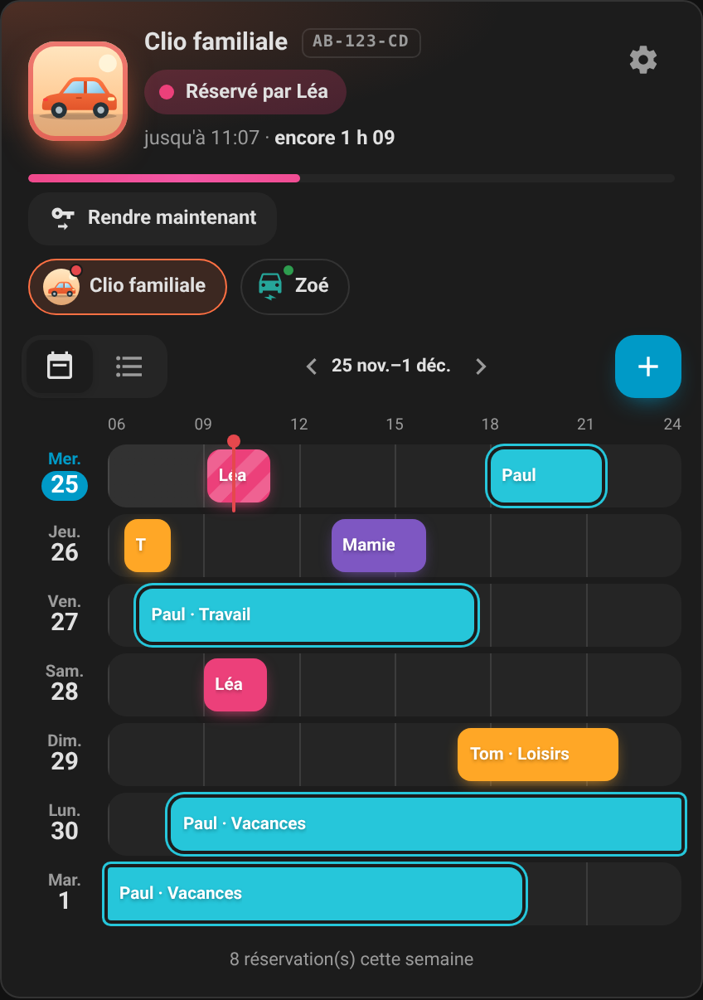 | 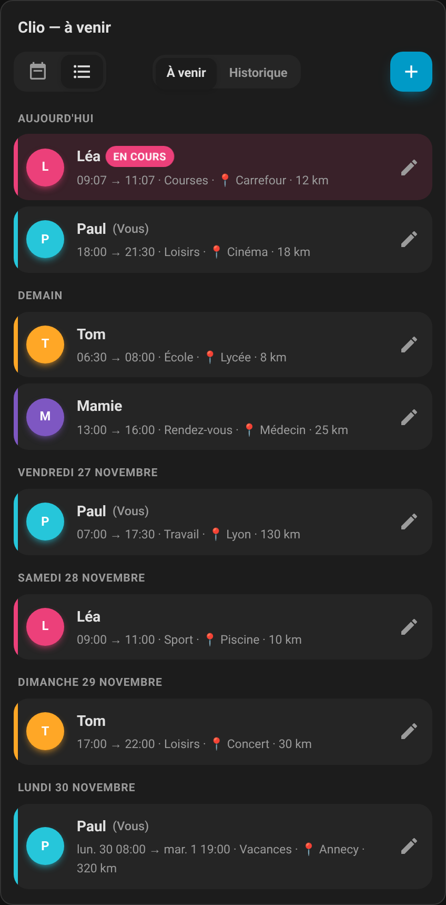 |

---

## Installation

### Avec HACS (recommandé)

1. HACS → menu ⋮ → **Dépôts personnalisés** → ajoutez `https://github.com/kaaribou/holm-booking-cars`, catégorie **Intégration**.
2. Recherchez **HOLM Booking Cars** → **Télécharger**, puis redémarrez Home Assistant.

### Manuellement

Copiez `custom_components/holm_booking_cars` dans le dossier `custom_components` de votre configuration, puis redémarrez Home Assistant.

## Configuration

**Paramètres → Appareils et services → Ajouter une intégration → HOLM Booking Cars.**

Donnez le **nom du premier véhicule**. C'est tout : les **personnes** de Home Assistant sont reprises automatiquement (nom et compte), chacune avec sa couleur.

Ajoutez ensuite la carte **HOLM Booking Cars** à un tableau de bord (elle est déclarée automatiquement, pas de ressource à ajouter) et ouvrez la **roue crantée ⚙** pour ajouter d'autres véhicules, une photo, les notifications…

## La carte HOLM Booking Cars

### L'en-tête


- **La photo du véhicule** (ou son icône sur sa couleur), son **nom**, son **immatriculation** et, si vous l'avez indiqué, le **niveau de batterie ou de carburant** (en rouge sous 20 %).
- **Le statut**, avec un point qui pulse :
  - 🟢 **Disponible**, avec en dessous « Libre jusqu'à … » et qui part ensuite, ou « Rien de prévu » ;
  - 🟠 **Disponible**, mais une réservation commence dans moins d'une heure : « Léa part à 14:00 · dans 35 min » ;
  - 🔴 **Réservé par …**, sur la couleur de la personne, avec l'heure de retour et le temps restant (« encore 1 h 10 »).
- **La barre de progression** de la réservation en cours, à la couleur de la personne.
- **Rendre maintenant** (pour la personne qui a le véhicule, et les administrateurs) : termine la réservation en cours tout de suite, le véhicule redevient disponible.
- **La roue crantée ⚙** (administrateurs) ouvre les [réglages](#les-réglages-roue-crantée-).

Avec plusieurs véhicules, une **pastille par véhicule** permet de passer de l'un à l'autre ; son point indique son état (vert disponible, orange bientôt réservé, rouge réservé).

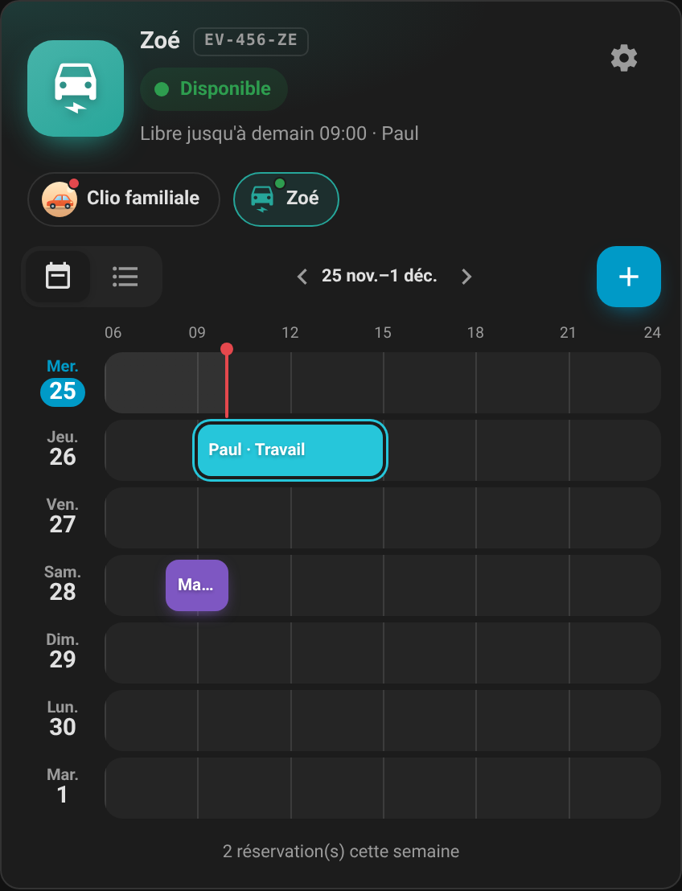

### La barre d'outils

- **Semaine / Liste** : les deux vues de la carte.
- **‹ 25 nov.–1 déc. ›** (vue semaine) : la semaine précédente ou suivante ; un appui sur les dates revient à aujourd'hui (elles s'affichent en couleur quand vous n'êtes pas sur la semaine en cours).
- **À venir / Historique** (vue liste) : les prochaines réservations, ou les réservations passées.
- **＋ Réserver** : une nouvelle réservation au prochain créneau libre (le bouton se réduit à **＋** sur une carte étroite).

### La vue semaine

- **Une ligne par jour** (aujourd'hui en premier par défaut), avec les heures en haut (de 6 h à minuit par défaut, voir les [options](#options-de-la-carte)).
- **Chaque réservation** est un bloc à la couleur de la personne, avec son nom et le motif quand il y a la place. Survolez-le pour voir les heures exactes.
- **Vos réservations** sont entourées d'un liseré ; **la réservation en cours** est rayée et animée ; les **réservations passées** sont plus pâles. Une réservation sur plusieurs jours s'étend sur chaque ligne.
- **Le trait rouge** marque l'heure actuelle ; la partie passée de la journée est grisée.
- **Touchez un créneau libre** : la fenêtre de réservation s'ouvre à cette heure-là, pour 2 h (ou jusqu'à la réservation suivante). **Touchez une réservation** pour la voir, la modifier ou la supprimer.
- En bas, le nombre de réservations de la semaine.
- Au changement de semaine, le planning **glisse** ; à l'ouverture, les blocs **se déploient** les uns après les autres.

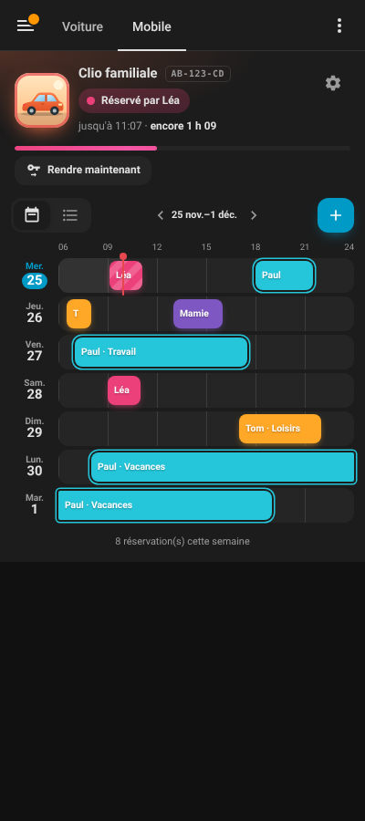

### La vue liste


Les réservations **groupées par jour** (Aujourd'hui, Demain, puis la date), avec l'initiale de la personne sur sa couleur, les heures, le motif, la destination 📍, les kilomètres et la note. **En cours** signale la réservation active. Le crayon ✏️ indique une réservation que vous pouvez modifier, la flèche › une réservation que vous pouvez seulement consulter.

### Réserver

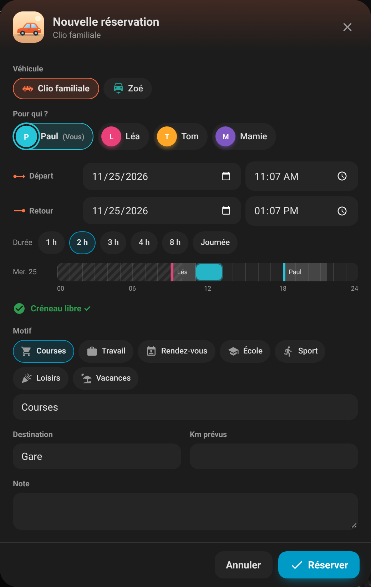

- **Véhicule** (s'il y en a plusieurs) et **Pour qui ?** : vous êtes choisi par défaut (« Vous »), touchez une autre personne pour réserver pour elle (elle est prévenue).
- **Départ** et **Retour** : date et heure. Changer le départ déplace le retour d'autant (la durée est gardée).
- **Durée** : 1 h, 2 h, 3 h, 4 h, 8 h ou **Journée** (8 h – 20 h) en un geste.
- **Les disponibilités** : une frise par jour concerné, avec les réservations des autres (grisées, au nom de la personne) et votre créneau en couleur.
- **Le message** : « Créneau libre ✓ » en vert, ou en rouge ce qui ne va pas (chevauchement avec qui et quand, retour avant le départ, durée trop longue, créneau passé). Le bouton **Réserver** reste grisé tant que c'est rouge.
- **Motif** : en un geste (Courses, Travail, Rendez-vous, École, Sport, Loisirs, Vacances) ou en toutes lettres.
- **Destination**, **Km prévus** et **Note** : facultatifs.
- **Réserver** : une coche se dessine, « Réservé ! Bonne route ! », puis la nouvelle réservation apparaît avec un petit rebond dans le planning.

| Un chevauchement | Sur mobile |
|---|---|
| 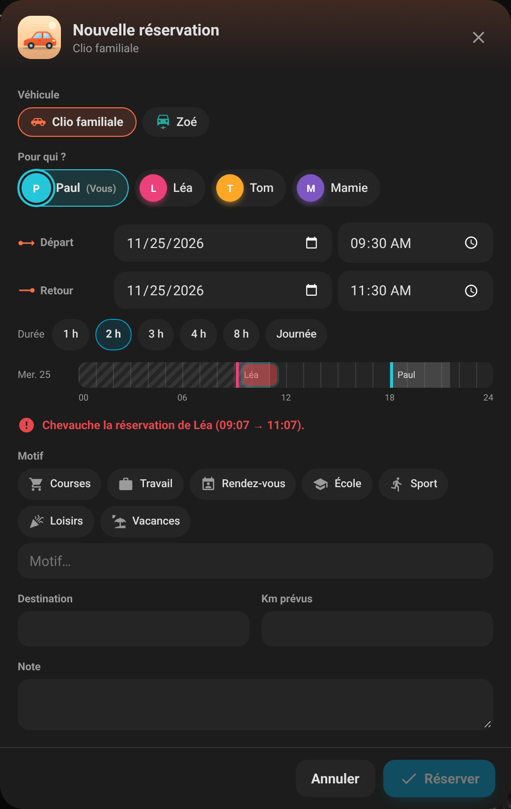 | 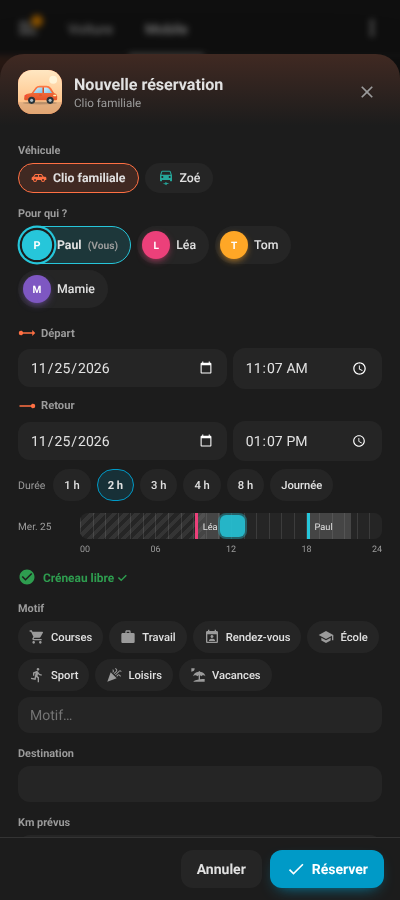 |

Sur mobile, la fenêtre monte du bas de l'écran.

### Modifier, supprimer

Touchez une réservation (bloc ou ligne de la liste) :

- si vous pouvez la modifier, la même fenêtre s'ouvre, avec **Supprimer** en bas à gauche (une confirmation est demandée) et « Réservé par … le … » ;
- sinon elle s'ouvre **en lecture seule**, avec la personne qui peut la modifier.

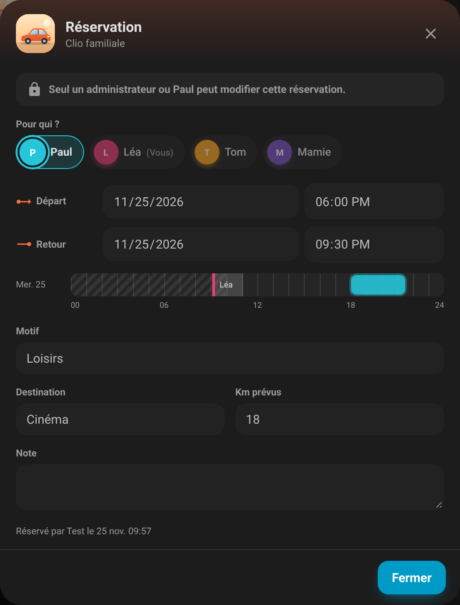

**Qui peut modifier quoi ?** Chacun ses réservations (celles faites par lui, ou à son nom), et les administrateurs toutes. L'option *Tout le monde peut modifier toutes les réservations* lève cette limite.

Les cartes ouvertes se mettent à jour **en direct** : une réservation faite par quelqu'un d'autre apparaît aussitôt, sans recharger la page. Si la réservation que vous regardez est supprimée ailleurs, la fenêtre se ferme avec un message.

### Les réglages (roue crantée ⚙)

Réservés aux administrateurs. Trois onglets ; rien n'est enregistré avant **Enregistrer**.

**Véhicules**

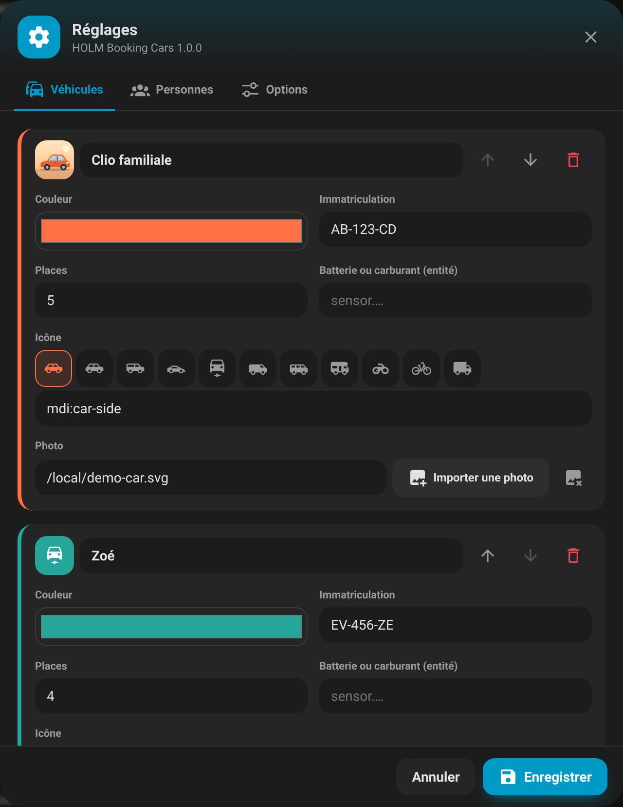

- **Nom**, **Couleur**, **Immatriculation**, **Places**.
- **Batterie ou carburant (entité)** : un capteur en % (ou km, L) affiché dans l'en-tête, par exemple le niveau de batterie de [HOLM Cars](https://github.com/kaaribou/holm-cars).
- **Icône** : une des icônes proposées ou n'importe quelle `mdi:…`.
- **Photo** : **Importer une photo** depuis votre téléphone ou ordinateur, ou indiquez une adresse (`/local/…`, `https://…`). L'icône 🖼️✕ retire la photo.
- ↑ ↓ pour l'ordre, 🗑️ pour supprimer (deux appuis : le premier demande confirmation ; ses réservations sont effacées à l'enregistrement).
- **Ajouter un véhicule**. Ajouter, supprimer ou renommer un véhicule recrée ses entités.

**Personnes**

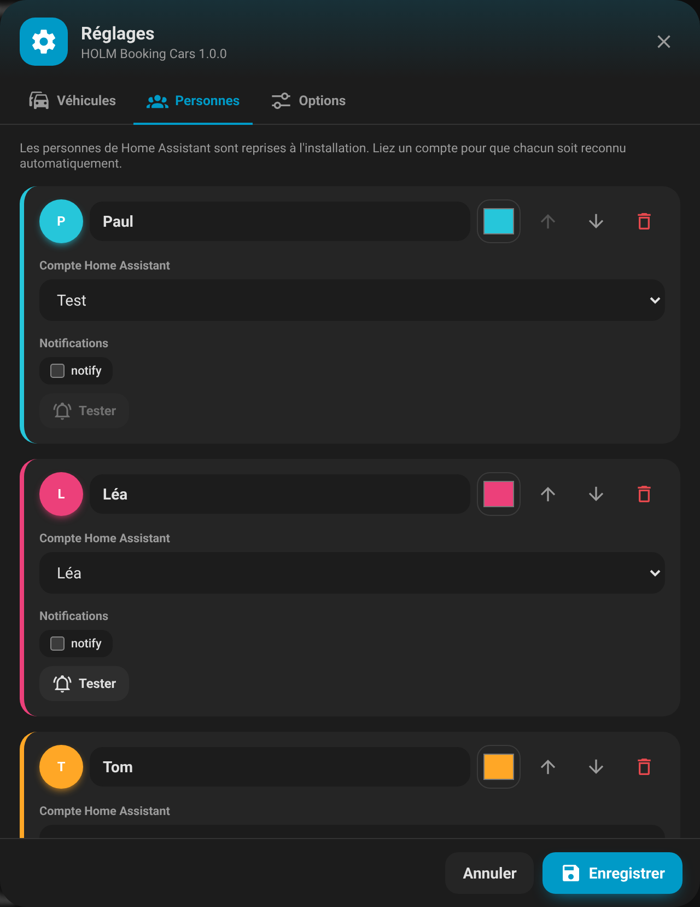

- **Nom** et **couleur** (celle des réservations).
- **Compte Home Assistant** : la personne est reconnue automatiquement quand elle ouvre la carte (« Vous »), et peut modifier ses réservations.
- **Notifications** : les appareils qui reçoivent ses rappels et alertes (application mobile, ou tout service `notify`). **Tester** envoie une notification d'essai (enregistrez d'abord).
- **Ajouter une personne** : aussi pour quelqu'un sans compte (« Mamie »), pour qui les autres réservent.

**Options**

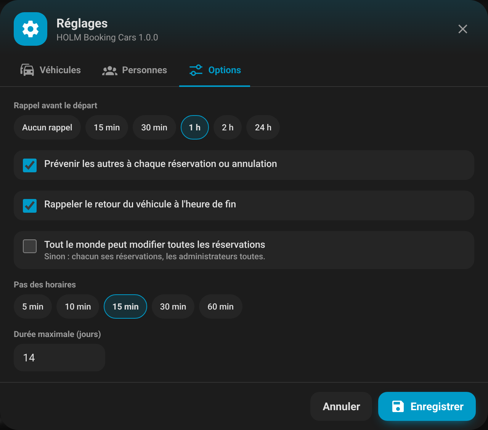

- **Rappel avant le départ** : aucun, 15 min, 30 min, 1 h, 2 h ou 24 h avant (pas de rappel pour une réservation faite au dernier moment).
- **Prévenir les autres à chaque réservation ou annulation**.
- **Rappeler le retour du véhicule à l'heure de fin**.
- **Tout le monde peut modifier toutes les réservations**.
- **Pas des horaires** : 5, 10, 15, 30 ou 60 minutes pour le choix des heures.
- **Durée maximale (jours)** d'une réservation (14 par défaut).

### Options de la carte

Toutes réglables dans l'éditeur visuel :

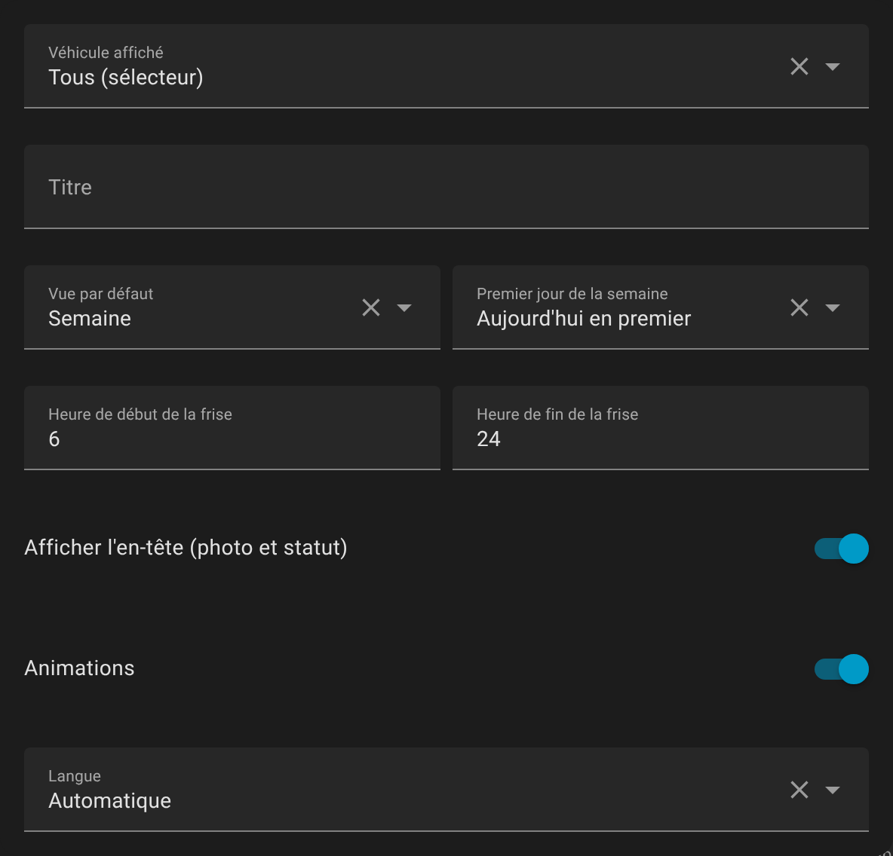

```yaml
type: custom:holm-booking-cars-card
vehicle: clio            # facultatif : un seul véhicule (sinon pastilles pour choisir)
title: Voiture           # facultatif
view: week               # week (semaine) ou list (liste)
first_day: today         # today (aujourd'hui en premier), monday ou sunday
hours_from: 6            # heure de début de la frise
hours_to: 24             # heure de fin de la frise
show_header: true        # photo et statut
animations: true
language: auto           # ou fr, en, de, es, it, nl, pt, pl
```

| Option | Défaut | Effet |
|---|---|---|
| `vehicle` | tous | Identifiant du véhicule à afficher seul (`clio` pour `sensor.clio_statut`). |
| `title` | — | Titre au-dessus de la carte. |
| `view` | `week` | Vue à l'ouverture. |
| `first_day` | `today` | Premier jour de la semaine affichée. |
| `hours_from` / `hours_to` | `6` / `24` | Plage d'heures de la vue semaine. |
| `show_header` | `true` | Masquez l'en-tête pour une carte « liste » compacte. |
| `animations` | `true` | Désactive toutes les animations (elles le sont aussi si votre appareil demande de réduire les animations). |
| `language` | `auto` | Langue de la carte (sinon celle de votre profil). |

La carte suit votre thème, clair ou sombre :

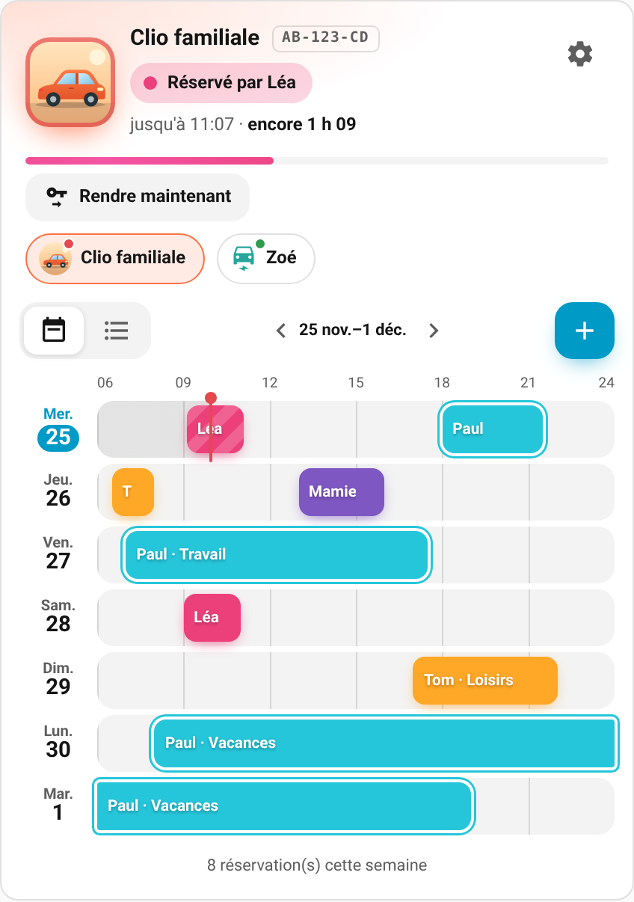

## Entités

Pour chaque véhicule (ici `clio`) :

| Entité | État | Attributs |
|---|---|---|
| `sensor.clio_statut` | `disponible`, `bientot` (réservé dans moins d'1 h), `reserve` | `person`, `until`, `reason`, `destination`, `next_start`, `next_person`, `color`, `plate` |
| `sensor.clio_en_cours` | Nom de la personne qui a le véhicule (vide sinon) | `start`, `end`, `reason`, `destination`, `booking_id` |
| `sensor.clio_prochaine_reservation` | Date et heure de la prochaine réservation | `person`, `end`, `reason`, `destination`, `booking_id` |
| `binary_sensor.clio_disponible` | `on` quand personne n'a le véhicule | — |
| `calendar.clio` | Les réservations (« Léa — Courses », lieu = destination) | — |

Le **calendrier** accepte aussi la création, la modification et la suppression depuis le calendrier de Home Assistant : un événement « Léa — Piscine » est réservé pour Léa avec le motif « Piscine » (le chevauchement reste refusé).

## Actions

- `holm_booking_cars.book` : réserve (`vehicle`, `person`, `start`, `end`, `reason`, `destination`, `km`, `note`) et renvoie la réservation. Refusée en cas de chevauchement.
- `holm_booking_cars.cancel` : supprime une réservation (`booking_id`).
- `holm_booking_cars.finish` : termine maintenant la réservation en cours d'un véhicule (`vehicle`).

```yaml
action: holm_booking_cars.book
data:
  vehicle: clio
  person: lea
  start: "2026-12-01 08:00:00"
  end: "2026-12-01 12:00:00"
  reason: Courses
```

## Évènement

`holm_booking_cars_booking` à chaque changement, avec `action` (`created`, `updated`, `deleted`, `started`, `ended`), `booking_id`, `vehicle`, `vehicle_name`, `person`, `person_name`, `start`, `end`, `reason`, `destination`. Par exemple, allumer l'éclairage de l'allée quand une réservation commence la nuit :

```yaml
triggers:
  - trigger: event
    event_type: holm_booking_cars_booking
    event_data:
      action: started
```

## Bon à savoir

- **Les réservations passées** restent 120 jours dans l'historique.
- **Les heures** s'affichent dans le fuseau de votre appareil ; les notifications dans celui de Home Assistant.
- **Les notifications** sont envoyées dans la langue de Home Assistant.

## FAQ

**« HOLM Booking Cars n'est pas installé »** s'affiche dans la carte. Ajoutez l'intégration dans *Paramètres → Appareils et services*, ou vérifiez qu'elle a démarré (journal).

**Je ne suis pas reconnu (« Vous » n'apparaît pas).** Dans les réglages, onglet *Personnes*, liez votre **compte Home Assistant** à votre nom.

**Je ne reçois pas de notification.** Cochez vos appareils dans l'onglet *Personnes*, enregistrez, puis **Tester**.

**Je ne peux pas modifier une réservation.** Elle n'est pas à vous : demandez à la personne ou à un administrateur, ou activez *Tout le monde peut modifier toutes les réservations*.

---

## Un petit merci ?

L'intégration vous plaît ? Vous pouvez m'offrir une bière 🍺

[](https://paypal.me/kaaribou)

---

## Licence

Code : licence **MIT** — © kaaribou. Voir le [CHANGELOG](CHANGELOG.md).

Fait partie de **HOLM — Home Orchestration & Living Management** : la gestion et l'orchestration intelligente de la maison.

Les autres projets : [HOLM Cars](https://github.com/kaaribou/holm-cars) · [HOLM Poubelles](https://github.com/kaaribou/holm-bins) · [HOLM My Menu](https://github.com/kaaribou/holm-mymenu) · [HOLM HP/HC](https://github.com/kaaribou/holm-tarif) · [HOLM Navbar Card](https://github.com/kaaribou/holm-navbar-card) · [HOLM Shortcuts](https://github.com/kaaribou/holm-shortcuts) · [HOLM FX](https://github.com/kaaribou/holm-fx-card) · [HOLM Family Card](https://github.com/kaaribou/holm-family-card).
